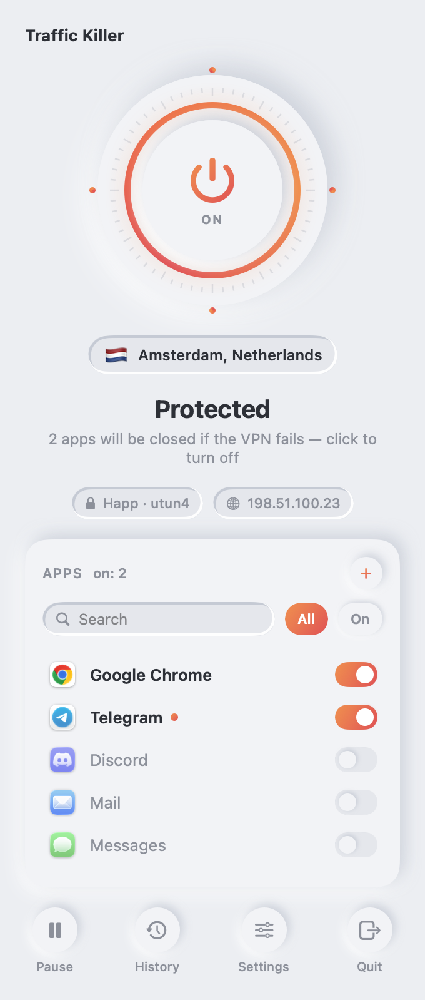
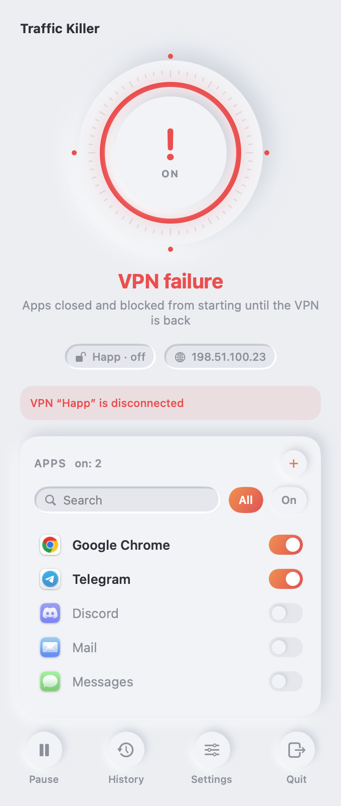

# Traffic Killer

**Real IP leak protection when your VPN fails** — for macOS and Windows.

**English** · [Русский](README.ru.md)

If your VPN drops or traffic starts bypassing the tunnel, Traffic Killer instantly closes the apps you
choose and keeps them from starting until the VPN is back — before they get a chance to use your real IP.

<p align="center">
  
  &nbsp;&nbsp;
  
</p>

## Download

**Current version: 1.2.1** (4 Nov 2026) · [what's new](../../releases/latest). The links below always lead to the newest version.

| Platform | File | Version | Requirements |
|---|---|---|---|
| macOS | [**TrafficKiller-macOS.dmg**](../../releases/latest/download/TrafficKiller-macOS.dmg) | 1.2.1 | macOS 14 Sonoma or newer, Apple Silicon or Intel |
| Windows (most PCs) | [**TrafficKiller-Windows-x64.exe**](../../releases/latest/download/TrafficKiller-Windows-x64.exe) | 1.2.1 | Windows 10 / 11, 64-bit Intel or AMD |
| Windows on ARM | [**TrafficKiller-Windows-arm64.exe**](../../releases/latest/download/TrafficKiller-Windows-arm64.exe) | 1.2.1 | Windows 11 on Snapdragon and other ARM laptops |

<details>
<summary><b>Archived versions</b></summary>

Older builds stay available if you need to go back. Use the current version unless you have a reason not to.

| Version | Date | Changes | Downloads |
|---|---|---|---|
| 1.2 | 4 Nov 2026 | Theme choice on macOS | [macOS](../../releases/download/v1.2/TrafficKiller-macOS.dmg) · [Windows x64](../../releases/download/v1.2/TrafficKiller-Windows-x64.exe) · [Windows ARM](../../releases/download/v1.2/TrafficKiller-Windows-arm64.exe) · [notes](../../releases/tag/v1.2) |
| 1.1 | 4 Nov 2026 | VPN location and flag on the icon; first public release | [macOS](../../releases/download/v1.1/TrafficKiller-macOS.dmg) · [Windows x64](../../releases/download/v1.1/TrafficKiller-Windows-x64.exe) · [Windows ARM](../../releases/download/v1.1/TrafficKiller-Windows-arm64.exe) · [notes](../../releases/tag/v1.1) |

</details>

All versions and release notes: [Releases](../../releases). Each release lists SHA-256 checksums in
`SHA256SUMS.txt`; to verify a download:

```bash
shasum -a 256 TrafficKiller-macOS.dmg                          # macOS
```
```powershell
Get-FileHash .\TrafficKiller-Windows-x64.exe -Algorithm SHA256  # Windows PowerShell
```

## Install

### macOS
1. Open `TrafficKiller-macOS.dmg` and drag **Traffic Killer** into **Applications**.
2. Launch it from Applications. The app is not signed with an Apple Developer certificate yet, so the
   first launch shows *“Apple could not verify Traffic Killer…”*. Click **Done**, open
   **System Settings → Privacy & Security**, scroll down and click **Open Anyway**. Or, in Terminal:
   ```bash
   xattr -dr com.apple.quarantine "/Applications/Traffic Killer.app"
   ```
3. Go through the setup assistant: pick your VPN, choose the apps to protect, allow notifications.

The shield icon appears in the menu bar. Traffic Killer starts at login by itself.

### Windows
1. Download the `.exe` for your PC (x64 for almost every computer, arm64 for ARM laptops).
2. Put it anywhere you like, for example `C:\Users\<you>\Apps\TrafficKiller.exe`, and run it. It is a single
   file with everything built in — nothing else to install.
3. The file is not code-signed yet, so SmartScreen may say *“Windows protected your PC”*: click
   **More info → Run anyway**.
4. On first launch it turns on *start with Windows* and opens Settings on the **Apps** tab.

The power icon appears in the notification area next to the clock (it may be hidden under the **^** arrow —
drag it onto the taskbar to keep it visible).

## How to use

1. **Choose your VPN.** *Settings → VPN & IP.* On macOS pick the VPN connection (Happ, IKEv2, any App Store
   VPN — whatever is listed in System Settings → VPN) or *Any utun tunnel* for WireGuard / OpenVPN apps without
   a system profile. On Windows *Any VPN tunnel* works for WireGuard, OpenVPN, Wintun, TAP, PPP and IKEv2; or
   pick a specific adapter.
2. **Switch on the apps to protect.** In the app list every installed app has a switch. **+** adds a running
   app, any other app or a process by name. Your VPN client itself is marked and is never closed.
3. **Turn protection on** with the big button. Its ring and the menu bar / tray icon show the state:

   | Icon | Meaning |
   |---|---|
   | orange | protected: apps will be closed if the VPN fails |
   | red | failure: the VPN is down or traffic bypasses it, listed apps are closed and blocked |
   | yellow | paused |
   | grey / outline | protection off: failures are only tracked |

4. **VPN location.** Under the button you see where your traffic exits — the flag and *City, Country* of the
   VPN server — and the same flag sits on the menu bar icon (on Windows: a country code badge on the tray icon).
5. **Pause** for 15 minutes, 1 or 3 hours when you deliberately need to go without the VPN.
6. **History** shows every failure: when, why, which apps were closed and how fast.

### What counts as a failure

| Check | Default |
|---|---|
| The VPN connection is not “Connected” | failure |
| The IPv4 default route does not go through the VPN tunnel | failure |
| IPv6 traffic bypasses the tunnel | failure (can be turned off) |
| The public IP equals your real IP (learned automatically while the VPN is off) | failure |
| DNS servers are reached outside the tunnel | warning (can be made a failure) |
| The IP check service is unreachable | not a failure |

### Useful settings
- **Instant / graceful close** — kill at once, or let apps close their windows first.
- **Block launches until the VPN is back** — a listed app is closed again as soon as it starts.
- **Reopen apps when the VPN is back** — apps closed during a failure are reopened after 3 seconds of stable VPN.
- **Strict mode (macOS)** — a firewall (pf) rule: your user's traffic can leave only through the VPN. When the VPN
  drops, the system drops every packet, so not a single one goes out over your real IP. Needs the admin password once.
- **Firewall layer (Windows)** — when run as administrator, protected programs are also blocked in Windows Firewall
  for the duration of a failure.
- **Language** — English or Russian, follows the system by default.
- **Theme (macOS)** — system default, light or dark, in Settings → General.

## FAQ

<details>
<summary><b>Is Traffic Killer a VPN?</b></summary>

No. It works together with the VPN you already use. It watches the connection and closes the chosen apps when the
VPN stops protecting them.
</details>

<details>
<summary><b>Which VPNs are supported?</b></summary>

Practically all. On macOS: anything shown in System Settings → VPN (Happ, IKEv2/IPsec, App Store VPN apps), plus
WireGuard, OpenVPN, Outline and others through *Any utun tunnel*. On Windows: WireGuard, OpenVPN, Wintun-based clients
(Hiddify, sing-box, v2rayN in TUN mode), TAP, PPP and built-in IKEv2.

Proxy-only modes (a SOCKS/HTTP proxy without a TUN interface) are not a tunnel, so they are reported as “no VPN”.
</details>

<details>
<summary><b>Why does macOS say it cannot verify the developer / Windows show SmartScreen?</b></summary>

The builds are not signed with paid Apple Developer ID / Windows code-signing certificates yet. The warning is about the
missing signature, not about malware. Use **Open Anyway** (macOS) or **More info → Run anyway** (Windows), and check
the SHA-256 checksum from the release if you want to be sure the file is the original.
</details>

<details>
<summary><b>Does it collect or send my data?</b></summary>

No analytics, no accounts, no servers of its own. Settings and history are stored locally. The only network requests are:
- the public IP check (ipify, icanhazip, ifconfig.me) — to notice when traffic goes out over your real IP;
- the VPN location lookup (ipwho.is, with fallbacks) — sends only the VPN exit IP and only while the VPN is connected.
  You can turn it off in Settings → VPN & IP → *Show the VPN location*.
</details>

<details>
<summary><b>Will my apps lose data when they are closed?</b></summary>

“Instant” mode kills the app the way a crash would, so unsaved work in that app is lost — this is the price of not
letting a single request go out. Choose “Graceful” in Settings if you prefer apps to close their windows first
(a little slower).
</details>

<details>
<summary><b>Protection triggered although my VPN is connected. Why?</b></summary>

Look at the reason in the menu or in History. Common causes:
- **IPv6 bypasses the tunnel** — your VPN only tunnels IPv4 while your ISP gives you IPv6. Enable IPv6 in the VPN
  or turn off the IPv6 check;
- **split tunneling / “direct” routing** — the default route goes outside the VPN;
- **real IP match** — the public IP equals the address remembered while the VPN was off (for example, the VPN app
  is connected but passes traffic directly).
</details>

<details>
<summary><b>Does it protect apps that are not on the list?</b></summary>

Only apps on the list are closed. To cover everything, use **Strict mode** on macOS (all traffic of your user) or
the firewall layer on Windows (listed programs, at network level).
</details>

<details>
<summary><b>Can it hide my time zone so it matches the VPN country?</b></summary>

Not yet. Websites can compare your system time zone with the country of your IP. Changing the system time zone
automatically is possible and is being considered as an optional feature; until then, set the time zone manually
or use your browser's anti-fingerprinting mode (Firefox `privacy.resistFingerprinting` reports UTC).
</details>

<details>
<summary><b>Does it slow down the computer or drain the battery?</b></summary>

No noticeable impact: it reacts to system network events and runs a light check once a second; the public IP is
checked every 30 seconds.
</details>

<details>
<summary><b>How do I quit or uninstall it?</b></summary>

**Quit:** the *Quit* button in the menu (a normal quit is not restarted).

**Uninstall on macOS:** quit the app, turn off Strict mode if you enabled it, delete `/Applications/Traffic Killer.app`,
and optionally `~/Library/Application Support/Traffic Killer` and `~/Library/Logs/Traffic Killer`.
If the internet stops working after a crash in Strict mode: `sudo pfctl -a com.apple/250.TrafficKiller -F all`.

**Uninstall on Windows:** quit the app, turn off *Start with Windows* in Settings (or remove it in Task Manager →
Startup apps), delete the `.exe`, and optionally `%LOCALAPPDATA%\Traffic Killer`.
</details>

<details>
<summary><b>Where are the settings and logs?</b></summary>

- macOS: `~/Library/Application Support/Traffic Killer/` (config, history) and `~/Library/Logs/Traffic Killer/guard.log`
- Windows: `%LOCALAPPDATA%\Traffic Killer\` (`config.json`, `incidents.json`, `guard.log`)
</details>

<details>
<summary><b>Is the source code available?</b></summary>

This repository hosts the official builds and documentation. The app is released under the MIT License.
</details>

## Limitations

Without Strict mode Traffic Killer is not a network-level kill switch, so:
- whatever an app sent between the failure and its detection (usually milliseconds) may go out over your real IP;
- apps that are not on the list are not protected;
- WebRTC leaks inside the browser are not checked.

Do not rely on it as your only protection.

## Reporting problems

Open an [issue](../../issues) with your OS version, VPN app and what happened. Attach the log
(Settings → Log → *Show log file*) — it contains your public and real IP addresses, so remove them if you prefer.

## License

[MIT](LICENSE) © 2026 gShama1ch. Third-party components: [THIRD-PARTY-NOTICES.md](THIRD-PARTY-NOTICES.md).
