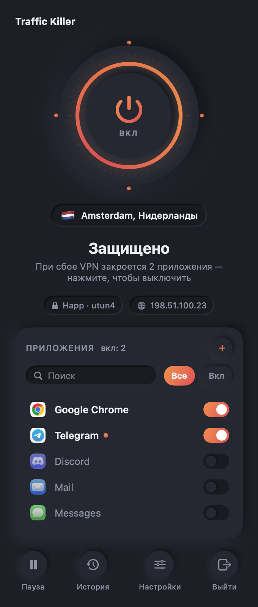

# Traffic Killer

**Защита от утечки реального IP при сбое VPN** — для macOS и Windows.

[English](README.md) · **Русский**

Если VPN отключился или трафик пошёл мимо туннеля, Traffic Killer мгновенно закрывает выбранные приложения
и не даёт им запуститься, пока VPN не вернётся, — раньше, чем они успеют выйти в сеть через ваш реальный IP.

<p align="center">
  
</p>

## Скачать

| Платформа | Файл | Требования |
|---|---|---|
| macOS | [**TrafficKiller-macOS.dmg**](../../releases/latest/download/TrafficKiller-macOS.dmg) | macOS 14 Sonoma и новее, Apple Silicon или Intel |
| Windows (большинство ПК) | [**TrafficKiller-Windows-x64.exe**](../../releases/latest/download/TrafficKiller-Windows-x64.exe) | Windows 10 / 11, 64-бит Intel или AMD |
| Windows на ARM | [**TrafficKiller-Windows-arm64.exe**](../../releases/latest/download/TrafficKiller-Windows-arm64.exe) | Windows 11 на Snapdragon и других ARM-ноутбуках |

Все версии и список изменений — в разделе [Releases](../../releases). К каждому релизу приложен
`SHA256SUMS.txt` с контрольными суммами. Проверить скачанный файл:

```bash
shasum -a 256 TrafficKiller-macOS.dmg                          # macOS
```
```powershell
Get-FileHash .\TrafficKiller-Windows-x64.exe -Algorithm SHA256  # Windows PowerShell
```

## Установка

### macOS
1. Откройте `TrafficKiller-macOS.dmg` и перетащите **Traffic Killer** в папку **Программы**.
2. Запустите приложение из Программ. Пока оно не подписано сертификатом Apple Developer, при первом запуске
   macOS скажет *«Не удалось проверить Traffic Killer…»*. Нажмите **Готово**, откройте
   **Системные настройки → Конфиденциальность и безопасность**, прокрутите вниз и нажмите **Всё равно открыть**.
   Или в Терминале:
   ```bash
   xattr -dr com.apple.quarantine "/Applications/Traffic Killer.app"
   ```
3. Пройдите мастер настройки: выберите VPN, приложения для защиты, разрешите уведомления.

Значок щита появится в строке меню. Traffic Killer сам запускается при входе в систему.

### Windows
1. Скачайте `.exe` для своего компьютера (x64 — почти для всех, arm64 — для ARM-ноутбуков).
2. Положите файл в любую папку, например `C:\Users\<вы>\Apps\TrafficKiller.exe`, и запустите. Это один файл,
   всё нужное уже внутри — ничего доустанавливать не надо.
3. Файл пока не подписан, поэтому SmartScreen может показать *«Система Windows защитила ваш компьютер»*:
   нажмите **Подробнее → Выполнить в любом случае**.
4. При первом запуске включается автозапуск с Windows и открываются настройки на вкладке **Приложения**.

Значок питания появится в области уведомлений рядом с часами (он может спрятаться под стрелкой **^** —
перетащите его на панель задач, чтобы всегда был на виду).

## Как пользоваться

1. **Выберите VPN.** *Настройки → VPN и IP.* На macOS — VPN-подключение (Happ, IKEv2, любые VPN из App Store —
   всё, что есть в Системных настройках → VPN) или *Любой туннель utun* для WireGuard / OpenVPN без системного
   профиля. На Windows *Любой VPN-туннель* подходит для WireGuard, OpenVPN, Wintun, TAP, PPP и IKEv2; или выберите
   конкретный адаптер.
2. **Включите приложения для защиты.** В списке у каждого установленного приложения есть переключатель. **+**
   добавляет запущенное приложение, любое другое или процесс по имени. Сам VPN-клиент помечен и никогда не закрывается.
3. **Включите защиту** большой кнопкой. Её кольцо и значок в строке меню / трее показывают состояние:

   | Значок | Что значит |
   |---|---|
   | оранжевый | защищено: при сбое VPN приложения будут закрыты |
   | красный | сбой: VPN отключён или трафик идёт мимо, приложения из списка закрыты и заблокированы |
   | жёлтый | пауза |
   | серый / контур | защита выключена: сбои только отслеживаются |

4. **Локация VPN.** Под кнопкой видно, где выходит ваш трафик, — флаг и *Город, Страна* VPN-сервера; тот же флаг
   стоит на значке в строке меню (на Windows — значок с кодом страны на иконке в трее).
5. **Пауза** на 15 минут, 1 или 3 часа — когда вы сознательно работаете без VPN.
6. **История** — все сбои: когда, почему, какие приложения закрыты и как быстро.

### Что считается сбоем

| Проверка | По умолчанию |
|---|---|
| VPN-подключение не в состоянии «Подключено» | сбой |
| Маршрут IPv4 по умолчанию идёт не через туннель VPN | сбой |
| IPv6-трафик идёт мимо туннеля | сбой (можно отключить) |
| Внешний IP совпадает с реальным (запоминается сам, пока VPN выключен) | сбой |
| DNS-серверы доступны мимо туннеля | предупреждение (можно сделать сбоем) |
| Сервис проверки IP недоступен | не сбой |

### Полезные настройки
- **Мгновенное / мягкое закрытие** — убить сразу или дать приложению закрыть окна.
- **Блокировать запуск до восстановления VPN** — приложение из списка закрывается снова, как только стартует.
- **Открывать приложения, когда VPN вернётся** — закрытые при сбое приложения открываются через 3 секунды стабильного VPN.
- **Строгий режим (macOS)** — правило файрвола pf: трафик вашего пользователя может выходить только через VPN.
  При обрыве VPN система отбрасывает каждый пакет — через реальный IP не уходит ни один. Нужен пароль администратора один раз.
- **Слой файрвола (Windows)** — при запуске от администратора защищённые программы на время сбоя ещё и блокируются
  в Брандмауэре Windows.
- **Язык** — русский или английский, по умолчанию как в системе.

## Частые вопросы

<details>
<summary><b>Traffic Killer — это VPN?</b></summary>

Нет. Он работает вместе с вашим VPN: следит за подключением и закрывает выбранные приложения, когда VPN перестаёт их защищать.
</details>

<details>
<summary><b>Какие VPN поддерживаются?</b></summary>

Практически все. На macOS — всё, что есть в Системных настройках → VPN (Happ, IKEv2/IPsec, VPN из App Store), а также
WireGuard, OpenVPN, Outline и другие через *Любой туннель utun*. На Windows — WireGuard, OpenVPN, клиенты на Wintun
(Hiddify, sing-box, v2rayN в режиме TUN), TAP, PPP и встроенный IKEv2.

Режим «только прокси» (SOCKS/HTTP без TUN-интерфейса) — не туннель, поэтому он определяется как «нет VPN».
</details>

<details>
<summary><b>Почему macOS не может проверить разработчика, а Windows показывает SmartScreen?</b></summary>

Сборки пока не подписаны платными сертификатами Apple Developer ID / Windows code signing. Предупреждение — об отсутствии
подписи, а не о вирусе. Нажмите **Всё равно открыть** (macOS) или **Подробнее → Выполнить в любом случае** (Windows);
чтобы убедиться, что файл оригинальный, сверьте SHA-256 из релиза.
</details>

<details>
<summary><b>Собирает ли приложение мои данные?</b></summary>

Нет аналитики, аккаунтов и собственных серверов. Настройки и история хранятся только на вашем компьютере. Сетевые запросы:
- проверка внешнего IP (ipify, icanhazip, ifconfig.me) — чтобы заметить выход через реальный IP;
- определение локации VPN (ipwho.is и резервные сервисы) — отправляется только IP VPN-сервера и только при подключённом VPN.
  Отключается в Настройки → VPN и IP → *Показывать локацию VPN*.
</details>

<details>
<summary><b>Потеряют ли приложения данные при закрытии?</b></summary>

В режиме «Мгновенно» приложение закрывается как при сбое, несохранённое в нём теряется — это цена того, что наружу не
уйдёт ни один запрос. Если важнее аккуратность, выберите в настройках «Мягко» — приложение сначала закроет окна (чуть медленнее).
</details>

<details>
<summary><b>Защита сработала, хотя VPN подключён. Почему?</b></summary>

Посмотрите причину в меню или в Истории. Частые случаи:
- **IPv6 идёт мимо туннеля** — VPN туннелирует только IPv4, а провайдер выдаёт IPv6. Включите IPv6 в VPN или отключите проверку IPv6;
- **раздельное туннелирование / «прямой» маршрут** — маршрут по умолчанию идёт мимо VPN;
- **совпал реальный IP** — внешний IP равен адресу, запомненному при выключенном VPN (например, VPN-приложение
  «подключено», но пускает трафик напрямую).
</details>

<details>
<summary><b>Защищает ли он приложения, которых нет в списке?</b></summary>

Закрываются только приложения из списка. Чтобы закрыть всё, используйте **Строгий режим** на macOS (весь трафик вашего
пользователя) или слой файрвола на Windows (программы из списка, на уровне сети).
</details>

<details>
<summary><b>Может ли он подменять часовой пояс под страну VPN?</b></summary>

Пока нет. Сайты могут сравнить часовой пояс системы со страной вашего IP. Автоматическая смена часового пояса системы
технически возможна и рассматривается как опциональная функция; пока выставьте пояс вручную или включите в браузере
защиту от отпечатков (в Firefox `privacy.resistFingerprinting` сообщает сайтам UTC).
</details>

<details>
<summary><b>Не тормозит ли компьютер и не садит ли батарею?</b></summary>

Заметного влияния нет: приложение реагирует на системные события сети и раз в секунду делает лёгкую проверку;
внешний IP проверяется раз в 30 секунд.
</details>

<details>
<summary><b>Как выйти или удалить приложение?</b></summary>

**Выйти:** кнопка *Выйти* в меню (после обычного выхода приложение само не перезапускается).

**Удалить на macOS:** выйдите из приложения, выключите Строгий режим, если включали, удалите `/Applications/Traffic Killer.app`,
при желании — `~/Library/Application Support/Traffic Killer` и `~/Library/Logs/Traffic Killer`.
Если после сбоя в Строгом режиме пропал интернет: `sudo pfctl -a com.apple/250.TrafficKiller -F all`.

**Удалить на Windows:** выйдите из приложения, выключите *Запуск с Windows* в настройках (или в Диспетчере задач →
Автозагрузка), удалите `.exe`, при желании — `%LOCALAPPDATA%\Traffic Killer`.
</details>

<details>
<summary><b>Где хранятся настройки и журнал?</b></summary>

- macOS: `~/Library/Application Support/Traffic Killer/` (настройки, история) и `~/Library/Logs/Traffic Killer/guard.log`
- Windows: `%LOCALAPPDATA%\Traffic Killer\` (`config.json`, `incidents.json`, `guard.log`)
</details>

<details>
<summary><b>Открыт ли исходный код?</b></summary>

В этом репозитории — официальные сборки и документация. Приложение распространяется по лицензии MIT.
</details>

## Ограничения

Без Строгого режима Traffic Killer — не сетевой kill switch, поэтому:
- то, что приложение успело отправить между сбоем и его обнаружением (обычно миллисекунды), может уйти через реальный IP;
- приложения не из списка не защищены;
- утечки WebRTC внутри браузера не проверяются.

Не полагайтесь на него как на единственную защиту.

## Сообщить о проблеме

Создайте [issue](../../issues): версия ОС, VPN-приложение и что произошло. Приложите журнал
(Настройки → Журнал → *Показать файл журнала*) — в нём есть ваш внешний и реальный IP, при желании удалите их.

## Лицензия

[MIT](LICENSE) © 2026 gShama1ch. Сторонние компоненты: [THIRD-PARTY-NOTICES.md](THIRD-PARTY-NOTICES.md).
